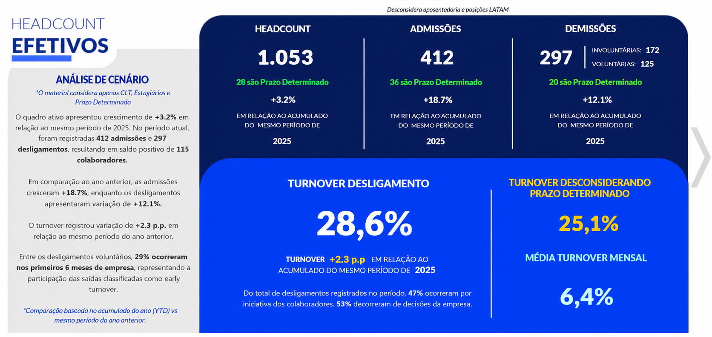
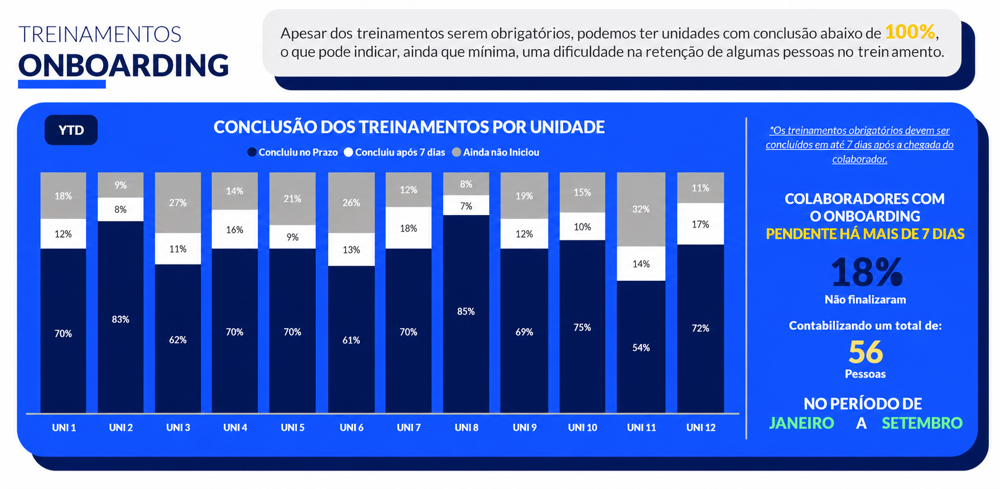
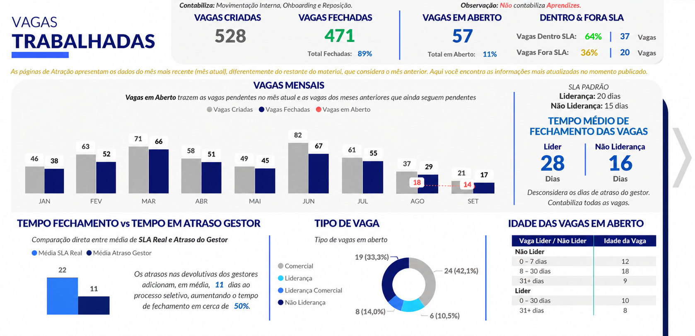

# Portfólio Pessoal — Isaac Moraes

> Portfólio profissional de **Analista de BI e Análise de Dados**, com foco em **People Analytics**, dashboards em **Power BI** e soluções analíticas orientadas à decisão.


---

## Sumário

- [Sobre o projeto](#sobre-o-projeto)
- [Status atual](#status-atual)
- [Estrutura das seções](#estrutura-das-seções)
- [Direção visual](#direção-visual)
- [Animações e interações](#animações-e-interações)
- [Responsividade](#responsividade)
- [Projetos em destaque](#projetos-em-destaque)
- [Estrutura do repositório](#estrutura-do-repositório)
- [Como executar localmente](#como-executar-localmente)
- [Publicação no GitHub Pages](#publicação-no-github-pages)
- [Aviso sobre dados fictícios](#aviso-sobre-dados-fictícios)
- [Roadmap](#roadmap)
- [Documentação](#documentação)
- [Licença e direitos de uso](#licença-e-direitos-de-uso)
- [Autor](#autor)

---

## Sobre o projeto

Este repositório reúne o **portfólio pessoal de Isaac Moraes**, analista de BI com formação em Análise e Desenvolvimento de Sistemas e pós-graduação em andamento em Ciência de Dados e Big Data.

O objetivo do site é apresentar, de forma clara e visualmente marcante:

- quem sou e como trabalho com dados;
- projetos de **Power BI**, dashboards e indicadores;
- ferramentas e nível de domínio em cada uma;
- trajetória profissional, formação e certificações;
- leituras e boas práticas que acompanham meu dia a dia;
- canais de contato.

O projeto seguiu um fluxo **design primeiro**: o visual foi prototipado e validado antes da implementação. O site final é **estático** (HTML, CSS e JavaScript puros, sem build nem dependências), leve e pronto para o GitHub Pages.

## Status atual

| Etapa | Situação |
| --- | --- |
| Análise da referência visual | Concluída |
| Estrutura das seções e direção visual | Concluída |
| Protótipo visual interativo (desktop e mobile) | Concluído (`design/`) |
| Conteúdo do projeto 01 (People Analytics) | Concluído |
| Conteúdo dos projetos 02, 03 e 04 | Em breve |
| **Implementação do site completo** | **Concluída (v1.0.0)** |
| Publicação (GitHub Pages) | Pronta para ativar |

> A versão final do site está na raiz do repositório (`index.html`, `css/`, `js/`, `assets/img/`). A pasta `design/` guarda apenas o protótipo.

## Estrutura das seções

| # | Seção | Conteúdo |
| --- | --- | --- |
| 1 | **Hero** | Nome, título "Analista de BI *insights*", subtítulo, localização (Diadema, SP) e indicador de scroll |
| 2 | **Sobre** | Apresentação profissional, formação e áreas de atuação |
| 3 | **Projetos em destaque** | Lista de cases com painel de detalhes, imagens ampliáveis e aviso de dados fictícios |
| 4 | **Processo** | Entender → Modelar → Visualizar → Decidir |
| 5 | **Stack** | Power BI, Power Query, DAX e Excel (avançado); SQL (intermediário); Python (básico) |
| 6 | **Trajetória** | Experiência, formação, certificações e iniciativas em que atuei |
| 7 | **Recomendações** | Depoimentos de colegas, vindos do LinkedIn |
| 8 | **Playbook** | Leituras selecionadas sobre BI e People Analytics |
| 9 | **Contato** | LinkedIn e GitHub |

Detalhes de cada seção em [`docs/ESTRUTURA-E-CONTEUDO.md`](docs/ESTRUTURA-E-CONTEUDO.md).

## Direção visual

Visual escuro, editorial e com textura, adaptado ao universo de dados:

- **Mesh gradient com grão (noise)** nos blocos de destaque;
- **Contraste tipográfico** entre uma sans geométrica e uma serifa itálica para a palavra de destaque de cada título;
- **Cartões arredondados** com bordas sutis e sombras longas e suaves;
- **Acentos quentes e frios** com função clara: âmbar para "insight" e turquesa para métricas.

### Paleta

| Token | Cor | Uso |
| --- | --- | --- |
| Fundo | `#0A0E1A` | Fundo da página |
| Superfície | `#10162A` | Cartões e painéis |
| Profundo | `#05070F` | Hero, contato e áreas de imagem |
| Texto | `#F4F6FB` | Texto principal |
| Texto secundário | `#B7C3DE` · `#9DB0D3` · `#8FA0C2` | Descrições e legendas |
| Rótulo | `#6F86B4` | Títulos de seção em caixa-alta |
| **Acento (insight)** | `#FFA800` | Destaques, botões e palavras em itálico |
| **Acento (métrica)** | `#00FFE0` | Datas, ícones e indicadores |
| Mesh | `#2D6AD8` · `#5B8DEF` | Gradientes e gráficos |

### Tipografia

- **Manrope** (400–800): títulos, textos e interface.
- **Playfair Display** (itálico): palavra de destaque dos títulos.

Ambas via Google Fonts, com licença aberta (SIL OFL).

Detalhes em [`docs/DIRECAO-VISUAL.md`](docs/DIRECAO-VISUAL.md).

## Animações e interações

- Título do hero revelado por máscara, linha a linha;
- Mesh gradient em deriva lenta, com grão fixo por cima;
- Cartão de vidro flutuante e indicador de scroll animado;
- Gráficos que crescem e linhas que se desenham;
- Reveal ao rolar a página (progressive enhancement com `animation-timeline: view()`);
- Elevação e realce de borda nos cartões ao passar o mouse;
- Troca de projeto no painel de destaque e ampliação de imagens em tela cheia;
- Rolagem suave ao clicar nos links do menu;
- Respeito a `prefers-reduced-motion`: usuários que preferem menos movimento não veem as animações.

## Responsividade

- **Desktop:** layout fluido com largura máxima de 1360 px e tipografia com `clamp()`.
- **Mobile:** versão pensada para 390 px, com seções empilhadas, alvos de toque de pelo menos 44 px e menu compacto.
- Grades com `auto-fit` / `minmax()` que se reorganizam sem pontos de quebra fixos.

## Projetos em destaque

### 01 · Dashboard Executivo de Gente & Gestão

Dashboard executivo desenvolvido para consolidar indicadores de Recursos Humanos, acompanhar a evolução da força de trabalho e permitir análises por período e estrutura organizacional. Reúne diferentes dimensões de People Analytics em uma visão integrada, voltada ao acompanhamento gerencial e à tomada de decisão.

**Ferramentas:** Power BI · DAX · Power Query

**Dimensões abrangidas**

- Força de trabalho: headcount e estrutura organizacional;
- Movimentações: admissões, desligamentos e turnover;
- Mobilidade interna: transferências e movimentações;
- Perfil organizacional: diversidade e demografia.

**Imagens** (em [`assets/projeto-01-people-analytics`](assets/projeto-01-people-analytics))

| Headcount Efetivos | Treinamentos Onboarding | Vagas Trabalhadas |
| --- | --- | --- |
|  |  |  |

> Todos os valores exibidos foram alterados e **não representam números reais**.

### 02 · Projeto profissional — *Em breve*

Case desenvolvido no ambiente de trabalho, em preparação.

### 03 e 04 · Projetos pessoais — *Em breve*

Projetos pessoais em construção.

## Estrutura do repositório

```text
portifolio-pessoal-isaacmoraes/
├── index.html                 # Site completo (página única)
├── favicon.svg
├── css/
│   └── styles.css             # Tokens, componentes, animações e responsividade
├── js/
│   └── main.js                # Menu, rolagem suave, reveal, abas, lightbox
├── assets/
│   ├── img/                   # Imagens otimizadas (WebP) usadas no site
│   └── projeto-01-people-analytics/  # Originais (PNG) do projeto 01
├── design/                    # Protótipo visual (fontes do canvas)
├── docs/
│   ├── DIRECAO-VISUAL.md
│   ├── ESTRUTURA-E-CONTEUDO.md
│   ├── DESIGN-PROTOTIPO.md
│   └── ROADMAP.md
├── README.md
├── CHANGELOG.md
└── .gitignore
```

## Como executar localmente

Não há dependências nem etapa de build. Basta servir a pasta com qualquer servidor estático:

```bash
git clone https://github.com/ZhackMorr/portifolio-pessoal-isaacmoraes.git
cd portifolio-pessoal-isaacmoraes
python3 -m http.server 8000
# abra http://localhost:8000
```

Também é possível abrir `index.html` direto no navegador. As fontes (Manrope e Playfair Display) são carregadas do Google Fonts; sem internet, o site usa fontes do sistema.

## Publicação no GitHub Pages

1. No repositório, abra **Settings › Pages**.
2. Em **Build and deployment**, escolha **Deploy from a branch**.
3. Selecione a branch `main` e a pasta `/ (root)` e salve.
4. Após alguns minutos, o site fica em `https://zhackmorr.github.io/portifolio-pessoal-isaacmoraes/`.

## Detalhes técnicos

- **Rolagem suave** própria (easing cúbico, cancelada por roda, toque ou teclado) com compensação do cabeçalho fixo;
- **Acessibilidade:** link "pular para o conteúdo", foco visível, abas com navegação por setas, lightbox em `<dialog>` com retorno de foco e `Esc`;
- **SEO:** metadados, Open Graph e JSON-LD (`Person`);
- **Desempenho:** imagens em WebP com `width`/`height` e `loading="lazy"`;
- **Movimento:** `prefers-reduced-motion` desativa as animações.

## Aviso sobre dados fictícios

Os dashboards exibidos neste portfólio tiveram **todos os indicadores alterados** antes da publicação. Eles servem apenas para demonstrar estrutura, organização visual e raciocínio analítico, e **não representam dados reais** de nenhuma empresa.

## Roadmap

- [x] Análise da referência visual
- [x] Proposta de seções e direção visual
- [x] Protótipo interativo desktop e mobile
- [x] Projeto 01 com imagens e documentação
- [x] Implementação do site completo
- [ ] Projetos 02, 03 e 04
- [ ] Ativar o GitHub Pages
- [ ] Definir a licença

## Documentação

| Documento | Conteúdo |
| --- | --- |
| [`docs/DIRECAO-VISUAL.md`](docs/DIRECAO-VISUAL.md) | Identidade visual, paleta, tipografia, efeitos e espaçamentos |
| [`docs/ESTRUTURA-E-CONTEUDO.md`](docs/ESTRUTURA-E-CONTEUDO.md) | Seções, textos e estado do conteúdo |
| [`docs/DESIGN-PROTOTIPO.md`](docs/DESIGN-PROTOTIPO.md) | Organização do protótipo e das imagens |
| [`docs/ROADMAP.md`](docs/ROADMAP.md) | Próximos passos |
| [`CHANGELOG.md`](CHANGELOG.md) | Histórico de versões |

## Licença e direitos de uso

Este repositório **não possui licença de código aberto definida**. Até que uma licença seja adicionada, todos os direitos são reservados. Textos, imagens e identidade visual são de autoria de Isaac Moraes.

A identidade visual deste projeto é original e foi inspirada apenas na estrutura geral de um brand board de portfólio (hero com mesh gradient, contraste entre sans e serifa itálica e cartões arredondados).

## Autor

**Isaac Moraes** — Analista de Inteligência de Dados, Diadema, SP

- LinkedIn: [linkedin.com/in/isaac-matos-38995a21b](https://www.linkedin.com/in/isaac-matos-38995a21b/)
- GitHub: [@ZhackMorr](https://github.com/ZhackMorr)
